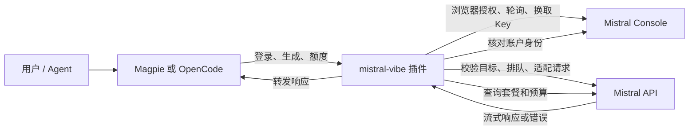

# Mistral Vibe Code for magpie / OpenCode

> 把你的 **Mistral Vibe Code 订阅**接进 [magpie](https://github.com/yetone/magpie) 与 OpenCode，让 Claude Code、Codex、OpenCode 等 agent 使用套餐内的月度 Vibe Code 额度。

非官方插件，与 Mistral AI 无隶属关系。Provider id：`mistral-vibe`。

---

## 项目来源

本插件由 [hxquan-q](https://github.com/hxquan-q) 自行开发和维护，代码发布在 [hxquan-q/magpie-mistral-code](https://github.com/hxquan-q/magpie-mistral-code)。开发过程中参考了 [songlairui/magpie-mistral-code](https://github.com/songlairui/magpie-mistral-code) 的实现思路；它是参考项目，并非本仓库的上游。

## 项目用途

这是一个用于学习和个人使用的接入项目：把你自己的 **Mistral Vibe Code 订阅**接入 Magpie 或 OpenCode，让 Claude Code、Codex 等 Agent 可以通过宿主调用该订阅可用的模型。项目也用于学习 Provider 插件如何处理授权、流式响应与额度展示。

插件只做接口适配，不提供订阅、共享账号或额外额度，也不以绕过服务限制为目的。请使用自己的账号和凭证，按套餐适用范围使用；请勿用于账号共享、转售、批量滥用或规避限流。第三方 Agent 能发起请求，不代表 Mistral 官方支持该接入；实际可用模型、额度和计费以服务方为准。

## 为什么需要它

Vibe Code 会先使用套餐包含的月度额度。每个组织的额度和超额付费设置由 Mistral 管理，实际扣账可在 Mistral 的用量页面核对。 [Mistral 订阅说明](https://docs.mistral.ai/admin/billing-usage/subscriptions)

## 安装

```powershell
magpie plugin add github:hxquan-q/magpie-mistral-code
magpie plugin login mistral-vibe          # 浏览器登录；窗口别关，链接出现后立刻点
```

装完在 agent 里选择 `mistral-vibe/<模型>`。已安装时，用 `magpie plugin list` 核对启用项及插件路径，再运行 `magpie provider test mistral-vibe` 验证聊天（会发送真实请求，可能计入用量）。列表显示已启用并不代表已打开的桌面会话重新加载了代码。

- [架构、登录／生成／额度流程与验证记录](docs/architecture.md)
- [交互架构图（下载后用浏览器打开）](docs/architecture.html)

## 登录与套餐确认

- **浏览器登录。** 在 Magpie 添加账号时选 `Sign in with Mistral (browser)`。打开链接后，用你的 Mistral 订阅账号登录。链接有效期为 10 分钟。
- **手动输入 Vibe CLI Key。** 到 Mistral 控制台的 `Code > Vibe CLI` 创建 Key，再在 Magpie 选 `Vibe Code API key` 粘贴。 [Vibe CLI 登录与 Key](https://docs.mistral.ai/vibe/code/cli/api-keys-profiles)

在 Magpie 的额度页刷新后，`whoami` 确认为 `CHAT / INDIVIDUAL` 的账号会显示 **Mistral Pro**。识别到 Studio API Key 时，额度卡会提示到哪里创建 Vibe CLI Key。显示 `Plan not confirmed` 时，可稍后刷新核对。

## 额度展示

额度卡以 Mistral 返回的额度和重置时间为准。在 Magpie 的额度页可以切换已用和剩余显示。`Pay as you go` 显示 Mistral 的超额付费设置。Magpie 依据已确认账号的月度额度做路由限额判定。只想用套餐内额度时，可以到 Mistral 订阅页确认 PAYG 已关闭。

`Budget unavailable` 表示本次未拿到可用的额度读数。`No monthly budget` 表示 Mistral 返回的月度额度为零。已有额度用完时会显示已用 100% 或剩余 0%，重置时间可用于确认何时恢复。身份未确认时，组织额度作为参考显示。有独立平台额度时，`Platform API credits` 也可供参考。

命令行核对：

```powershell
magpie quota mistral-vibe --json
```

对应上游端点：

| 用途 | 端点 |
| --- | --- |
| 套餐名 / PAYG 状态 | `GET api.mistral.ai/v1/billing/subscription` |
| 两本预算与重置时间 | `GET api.mistral.ai/v1/billing/budget` |
| 账号身份与权益 | `GET console.mistral.ai/api/vibe/whoami` |

## 模型

模型表来自 `GET /v1/models`（共 62 个，含 Codestral / Mistral / Ministral / GLM / DeepSeek 系列），上下文长度取接口的 `max_context_length`，名称与输出上限优先取 models.dev，价格用插件内置的官方定价表做估算。TTS、OCR、embedding 这类不产出文本的模型不会进入聊天模型列表。

## 环境变量

| 变量 | 作用 |
| --- | --- |
| `MISTRAL_VIBE_API_BASE` | 覆盖 LLM 基址（默认 `https://api.mistral.ai/v1`） |
| `MISTRAL_VIBE_CONSOLE_API` | 覆盖 console API 基址（默认 `https://console.mistral.ai/api`） |
| `MISTRAL_VIBE_MAX_CONCURRENCY` | 同一 key 的最大在途请求数（默认 4），用于避免多 agent 并发形成突发流量 |
| `MISTRAL_VIBE_MIN_INTERVAL_MS` | 同一 key 两次请求开始的最小间隔（默认 250ms；设为 `0` 关闭） |

## 实现思路与架构流程

插件是宿主与 Mistral 之间的适配层，不运行模型。登录取得凭证，生成和额度分别使用各自的接口，额度查询不阻塞聊天请求。



- **登录**：浏览器授权使用 PKCE，完成后兑换 Vibe Key；也可在宿主手动输入 Vibe CLI Key。
- **生成**：校验目标并取得发车名额后再出站。流结束、报错或取消才释放并发名额；遇到限流，由宿主决定如何处理。
- **额度**：把套餐、预算与账号身份合并成宿主可展示的数据。只共享同一账号和服务的在途刷新，下一次独立刷新重新读取。


agent 回传历史时会带 `reasoning_content` / `reasoning` / `reasoning_details`，而 Mistral 对未知字段返回 `422 Extra inputs are not permitted`。插件把这些思考内容改写成 Mistral 的 typed content part（thinking 块）放到该轮文本之前，因此带思考轮的会话不会中断。

出站请求以 `magpie-mistral-vibe/0.2.0` 标识插件。聊天 Bearer 仅发送到配置的 API 同源 `/chat/completions` 路径，有凭证的请求不跟随重定向。生成 POST 遇到连接中断不自动重放，429 和 `Retry-After` 原样交给宿主。成功响应的并发名额保留到响应体结束、取消或出错。相同服务和凭证的额度请求只合并在途刷新，不缓存结果。

## 排错

| 现象 | 处理 |
| --- | --- |
| `sign-in could not start (429)` | 登录发起端点有频率限制，停 15–30 分钟后**只试一次**，不要连点 |
| `ECONNRESET: The socket connection was closed unexpectedly` | 连接池里的旧 keep-alive 套接字被 Cloudflare 关掉了。插件已自动换连接重试（发起/轮询/交换各 3 次，轮询与交换在链接 10 分钟有效期内对 429、5xx、断网继续退避重试），无需手动处理；若仍出现，重跑 `magpie plugin login mistral-vibe` 即可 |
| `context deadline exceeded` / poll 429 | 链接 10 分钟内没点，重新 `magpie plugin login mistral-vibe` |
| `Budget unavailable` | 刷新额度页，或到 Mistral 用量页确认组织额度 |
| `Studio API key` | 用浏览器重新登录，或换成在 `Code > Vibe CLI` 创建的 Key |
| 模型列表为空 | 未登录成功；先 `magpie plugin list --json` 看 `signedIn` |

## 隐私

- **模型请求**：发送给配置的 Mistral API，包括生成所需的提示词、对话历史、工具数据，以及请求中附带的文件或图片内容。请在发送前移除不需要的敏感信息。
- **凭证与账户**：凭证由宿主管理。插件使用凭证进行生成、模型列表、额度及身份查询；不要把 Key、授权链接或完整请求日志贴进公开 Issue。
- **网络与第三方**：浏览器授权和身份查询访问 Mistral Console；模型目录可向 `models.dev` 查询公开模型元数据。代理和自定义基址会改变网络路径或数据接收方，请只使用信任的配置。数据保留及处理以各服务的隐私条款为准。

## 免责声明

这是独立开发的非官方插件，不代表 Mistral AI 或 Magpie。接口、套餐权益、额度、计费及访问限制由服务方决定，可能变更。插件展示的额度和费用不替代官方账单；使用前请核对当前套餐、超额付费设置及适用条款。软件按 MIT 许可证提供，详见下方许可证。

## 致谢

- 感谢 [songlairui/magpie-mistral-code](https://github.com/songlairui/magpie-mistral-code) 提供实现参考。
- 感谢 [LINUX DO](https://linux.do/) 社区的技术交流与分享。
## License

MIT，见 [LICENSE](LICENSE)。Mistral、Vibe 等名称与商标归 Mistral AI 所有。
