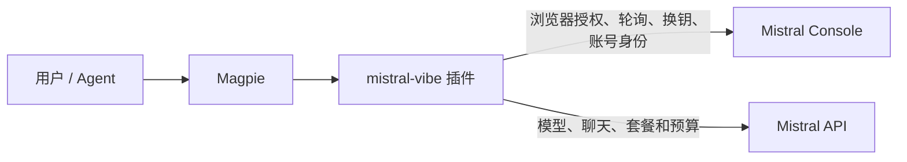

# Mistral Vibe Code for Magpie

让 WorkBuddy、Claude Code、Codex 等 Agent 通过 Magpie 使用你自己的 **Mistral Vibe Code 订阅额度**。浏览器登录后，Magpie 可以显示你的 Mistral Pro 套餐、月度额度和超额付费状态。

这是非官方插件。Provider ID 为 `mistral-vibe`。

## 用的是哪笔额度

插件拿当前账号的 Key 向 Mistral Console 的 `/vibe/whoami` 核对身份。额度页上的套餐名称来自这个结果。

| Magpie 额度页显示 | 怎么判断 |
| --- | --- |
| `Mistral Pro` | Mistral 把当前 Key 识别为个人 Pro 套餐（`CHAT / INDIVIDUAL`）。在 `Monthly Vibe Code` 查看该账号的月度额度。 |
| `Mistral Studio API` 和 `Studio API key` | Mistral 把当前 Key 识别为平台 API 凭证。接入 Pro 额度时，请用 Pro 账号浏览器登录，或选用该账号下有 Vibe 权益的工作区所创建的 Vibe CLI Key。 |
| `Plan not confirmed` | 当前套餐待确认。即使额度页读到了组织的 Vibe 预算，该读数也仅供参考。 |

## 安装和登录

```powershell
magpie plugin add github:hxquan-q/magpie-mistral-code
magpie plugin login mistral-vibe oauth
```

1. 在浏览器登录你的 Mistral 账号，选择有 Vibe 权益的工作区。保持终端开启，等 Magpie 完成登录。
2. 在 Magpie 额度页刷新 `Mistral Vibe Code` 账户，确认套餐和月度额度。
3. 在 Agent 的模型选择器里选 `mistral-vibe/<模型>`。

手动登录时，到 Mistral 控制台的 `Code > Vibe CLI` 创建 Key，在 Magpie 添加账号时选 `Vibe Code API key`。 [Mistral Vibe CLI 的 Key 文档](https://docs.mistral.ai/vibe/code/cli/api-keys-profiles)

已安装时可用 `magpie plugin list` 核对启用项和插件路径。如果旧桌面会话仍加载旧代码，结束当前任务后重启实际承载请求的 Magpie 进程。

## 查看用量和超额付费

在 Magpie 额度页刷新，或运行 `magpie quota mistral-vibe --json`。

| 项目 | 怎么看 |
| --- | --- |
| `Monthly Vibe Code` | 读取 `billing/budget` 返回的 `vibe_budget`，显示月度用量百分比。服务端返回预算金额和重置时间时也会显示。 |
| `Pay as you go` | 优先取 Vibe 预算里的超额付费开关，其次查订阅接口。`On` 表示开启，`Off` 表示关闭，`Unknown` 表示开关状态待确认。 |
| `Platform API credits` | 读取同一预算接口的 `api_budget`，作为平台用量参考。生成请求使用 Magpie 为当前模型分配的账号。 |

要核对一笔请求的实际用量，把 Agent 模型选为 `mistral-vibe/<模型>`，发一条短消息，再到 Mistral 用量页查看对应时段。也可以用 `magpie provider test mistral-vibe` 发送测试请求，这可能计入实际用量。 [Mistral 订阅说明](https://docs.mistral.ai/admin/billing-usage/subscriptions) · [Mistral 用量查询](https://docs.mistral.ai/admin/billing-usage/usage-limits)

## 登录和请求排错

| 看到什么 | 怎么处理 |
| --- | --- |
| 登录发起时出现 `429` | 等服务端限流恢复后重新发起一次，避免连续生成授权链接。 |
| 浏览器已经授权，终端还在等 | 保持终端开启。轮询遇到 `429` 时会遵守服务端的 `Retry-After`，也会在授权链接有效期内重试临时网络错误和 5xx。等待时间超过链接有效期时，重新发起登录。 |
| 换钥出现 `403/9004` | 这次授权所选的工作区没有 Vibe 权益。重新登录并选择有 Vibe 权益的工作区。 |
| `Plan not confirmed` 或 `Budget unavailable` | 刷新额度页，或到 Mistral 控制台核对当前组织。`No monthly budget` 表示服务端返回的月度额度为零。 |
| `Studio API key` | 重新用浏览器登录，或换成从 `Code > Vibe CLI` 创建的 Vibe Key。 |
| WorkBuddy 多轮对话出现 `422 extra_forbidden` | 核对当前会话加载的插件版本。本插件会清理消息里的宿主扩展字段，并保留思考内容、工具调用和工具结果的关联。 |
| 模型列表为空 | 核对账号登录状态，再运行 `magpie provider models mistral-vibe`。模型列表取自 Mistral API，可用模型随账号和服务变动。 |

## 插件如何工作



- **浏览器登录**使用 PKCE 校验授权。插件轮询 Mistral Console 提供的同源地址，拿到授权结果后，用换钥令牌和本地校验值交换 Vibe Key，并交给 Magpie 保存。轮询支持 `Retry-After` 的秒数和日期两种格式。换钥会重试临时网络错误、`429` 和 5xx，遇到 `403/9004` 会立即提示重选工作区。
- **聊天请求**由 Magpie 交给插件。插件校验目标是否为配置的 Mistral `/chat/completions`，再携带当前账号的 Key 发送。它会移除用户和助手消息上的宿主字段，例如 `conversationRequestId` 和 `messageId`，并清理文本片段上的 `annotations`。历史思考转换成 Mistral 支持的 `thinking` 片段，工具调用及其结果关联随请求保留。
- **生成限流**按 API 基址和 Key 控制并发及发出间隔。生成接口返回 `429` 时，插件把响应和 `Retry-After` 交还 Magpie，由 Magpie 决定后续处理。

更多细节见 [架构与请求流程](docs/architecture.md) 和 [交互架构图](docs/architecture.html)（下载到本地后用浏览器打开）。

## 配置和测试

| 环境变量 | 用途 |
| --- | --- |
| `MISTRAL_VIBE_API_BASE` | Mistral API 基址，默认 `https://api.mistral.ai/v1` |
| `MISTRAL_VIBE_CONSOLE_API` | Mistral Console API 基址，默认 `https://console.mistral.ai/api` |
| `MISTRAL_VIBE_MAX_CONCURRENCY` | 同一 API 基址和 Key 的最大在途生成请求数，默认 `4` |
| `MISTRAL_VIBE_MIN_INTERVAL_MS` | 同一 API 基址和 Key 的生成请求发出间隔，默认 `250` 毫秒，设为 `0` 可关闭 |

在仓库根目录运行 `bun test`。测试使用模拟接口覆盖授权到换钥、额度查询、工具调用请求格式及响应流。

## 数据与许可

宿主管理凭证。生成时会把提示词、对话历史、工具数据和随请求发送的附件交给所配置的 Mistral API。浏览器授权和身份查询访问 Mistral Console，公开模型元数据可从 `models.dev` 查询。提报问题时，请先移除 Key、授权链接及请求正文里的敏感数据。

项目由 [hxquan-q](https://github.com/hxquan-q) 自行开发和维护，开发中参考了 [songlairui/magpie-mistral-code](https://github.com/songlairui/magpie-mistral-code) 的实现。登录轮询退避及工作区权益提示参考了下游 [SammySnake-d/magpie-mistral-code](https://github.com/SammySnake-d/magpie-mistral-code)。感谢 [LINUX DO](https://linux.do/) 社区的交流。项目采用 [MIT 许可证](LICENSE)。
