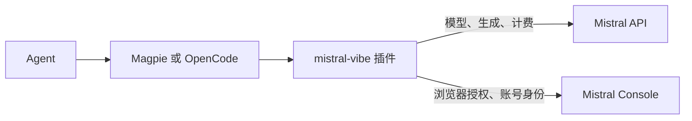

# 架构与请求流程

[打开交互架构图](architecture.html) · [图源 JSON](architecture.json)



## 三条业务路径

1. **登录**：从宿主发起浏览器授权，插件轮询授权结果并交换 Key；也可以直接在宿主输入 Vibe CLI Key。登录目标按各步骤分别校验。
2. **生成**：宿主调用插件 → 校验目标同源及路径 → 取得并发名额 → 适配请求体、附加凭证并发出 HTTPS 请求 → 将响应流交还宿主。带凭证请求禁止自动重定向。结果未知的生成 POST 不重放；`429` 和 `Retry-After` 由宿主处理。
3. **额度**：读取套餐、预算和账号身份；同服务、同凭证的并发刷新共享在途查询。完成结果不缓存，后续手动刷新重新查询。

实现见 [插件入口](../index.mjs)。[OpenCode 2 适配层](../opencode2.mjs#L231-L252) 直接交还响应；调用方放弃响应时应取消响应体或中止请求，否则并发名额会持续占用。自然结束、读取报错和主动取消均释放名额。

## 如何确认正在使用

```powershell
magpie plugin list
magpie provider test mistral-vibe
```

先在列表里核对启用项是否指向预期插件；旧会话如尚未重载，结束任务后重启实际承载请求的 Magpie 进程。Provider 测试会发起真实模型请求，可能计入用量。

本机实测：`deepseek-v4-1-flash-1017` 两次聊天测试成功。第二次期间观察到 Magpie 及插件宿主连接测试环境的本地代理。这只是 TCP 连接观测：未解密 TLS，未核对 HTTPS 域名、路径或请求头，也未验证已打开的桌面会话是否重载。不采集凭证或正文。

独立本地回归：`bun test` 50 通过、0 失败。重定向覆盖的是传给 `fetch` 的选项；流测试覆盖三条释放路径，但未单独隔离最小发送间隔的影响。
